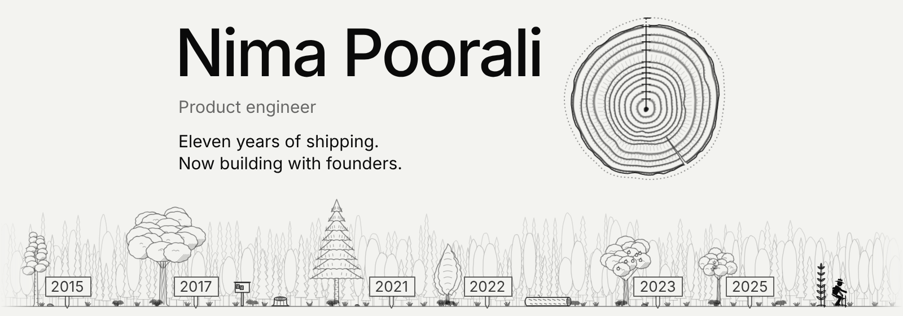

<!-- banner.png is a frame of reference/rings-forest-2/index.html in the poorali.dev repo, made like brand/banners.html there:
     1600 x 560 at zoom 2, with ?state=rest&still&lock=name,role,short&lines=1&min=15&slice=0.95&box=600x150@100,12
     &band=800x100@0,176&sign=0&scene=plant&seed=2. Render it again each January, when the year that ended gets its
     ring and "Eleven years" becomes "Twelve". -->

  

I’ve shipped web products since 2015, as a developer, a lead and a co-founder. Now I build them with founders.

**[Book a call](https://cal.com/poorali)** · [poorali.dev](https://poorali.dev) · [LinkedIn](https://www.linkedin.com/in/poorali/) · [hi@poorali.dev](mailto:hi@poorali.dev)

### Career

- 2015–2017 · **Dariche Zehn**, Frontend developer
- 2017–2021 · **Karaweb**, Full-stack developer
- 2021–2025 · **Upwork**, Freelancer: 4.5 years, 100% job success
- 2022–2023 · **QuadVentures**, Lead web developer
- 2023–2025 · **Aligned Voyage**, Co-founder of a SaaS for freelancer collaboration
- 2025–now · **mvneco**, Frontend consultant on a B2B subscription SaaS

**Next:** building AI products with founders, as their product engineer, product manager or advisor.

### How I work

- Acceptance criteria before code.
- Smoke tests before QA.
- Performance measured, not guessed.
- **I optimise for year three.**

### Skills

- **Architecture.** Micro-frontends, monorepos, framework migrations and fast first loads.
- **Design systems.** Built once as Web Components and used natively in Angular and React, so a system outlives its host framework.
- **Soft skills.** Cross-team collaboration, careful reviews of code and performance numbers, clear acceptance criteria and docs, an eye for UX and regressions.

---

Building something? Tell me about it: **[book a call](https://cal.com/poorali)** or write to [hi@poorali.dev](mailto:hi@poorali.dev).

Soon on YouTube and LinkedIn: I test new tech and AI-built gadgets in real life. 
Why the graph is quiet: client work ships on a private GitLab.
