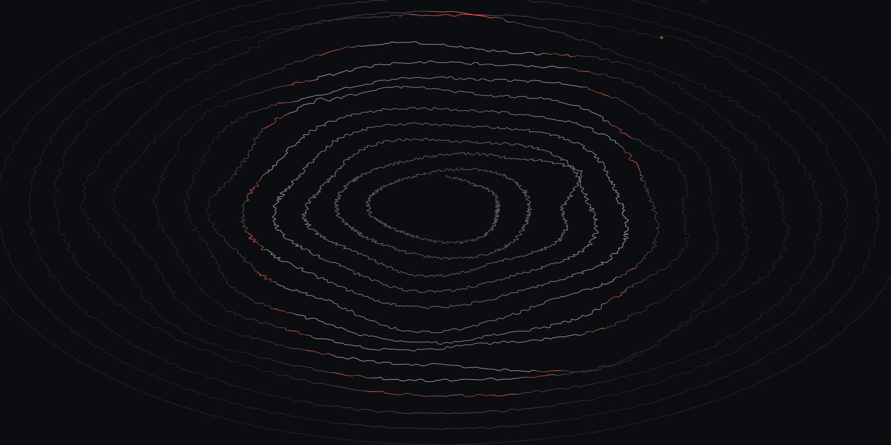

  

<em>I optimise for year three.</em> — one revolution per year
since 2015 · drawn from dates, not Math.random() ·
<a href="https://poorali.dev">the live drawing is one day longer</a> ·
redrawn every monday by <a href="https://github.com/poorali/rings">rings</a>

# Nima Poorali

Frontend architect & design-systems consultant. I build design systems as
**Web Components** — one implementation, consumed natively by **Angular** and
**React/Next** apps inside **Nx** monorepos.

- Currently: sole design-system architect at **mvneco** — a German B2B
  subscription-management SaaS (contract, remote)
- Before that: co-founded a freelancer-collaboration SaaS; 11 years across
  React, Angular, Vue, TypeScript, Node, Laravel
- Why the graph is quiet: client work ships on a private GitLab

[poorali.dev](https://poorali.dev) · [LinkedIn](https://www.linkedin.com/in/poorali/) · hi@poorali.dev
